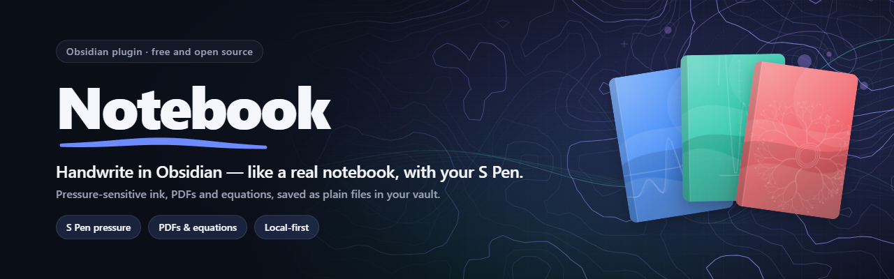
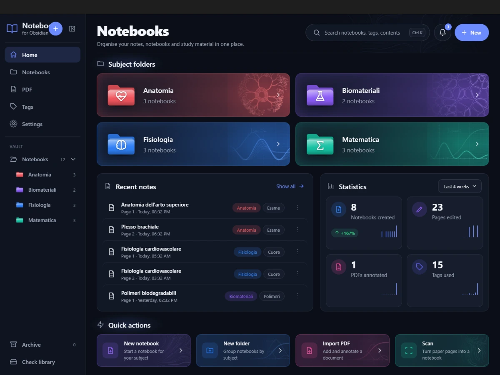
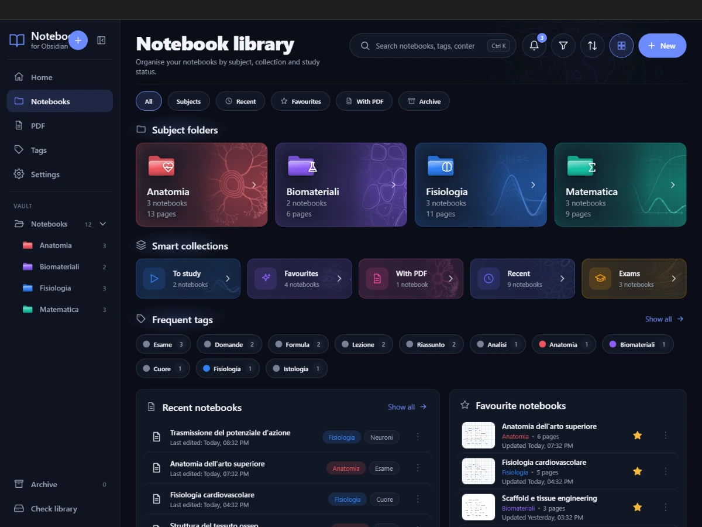
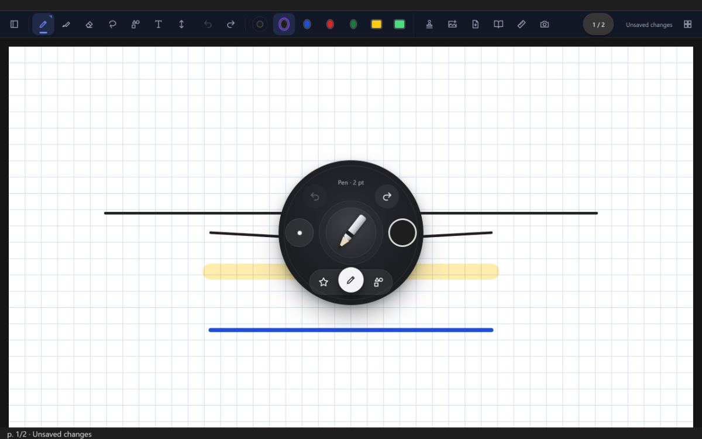
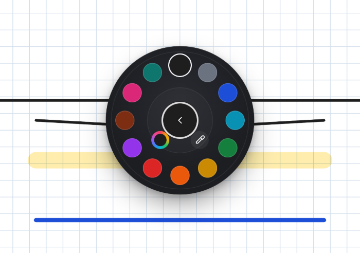
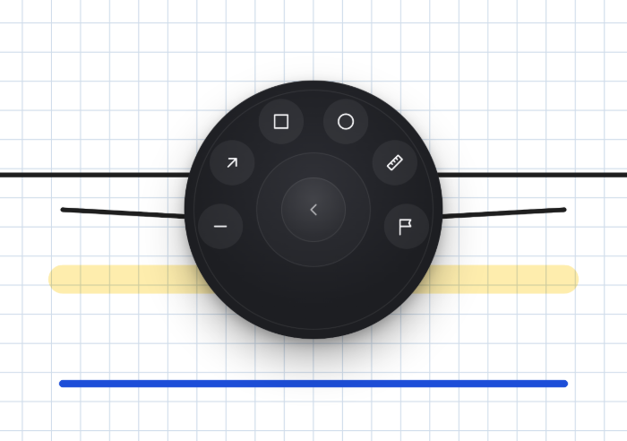
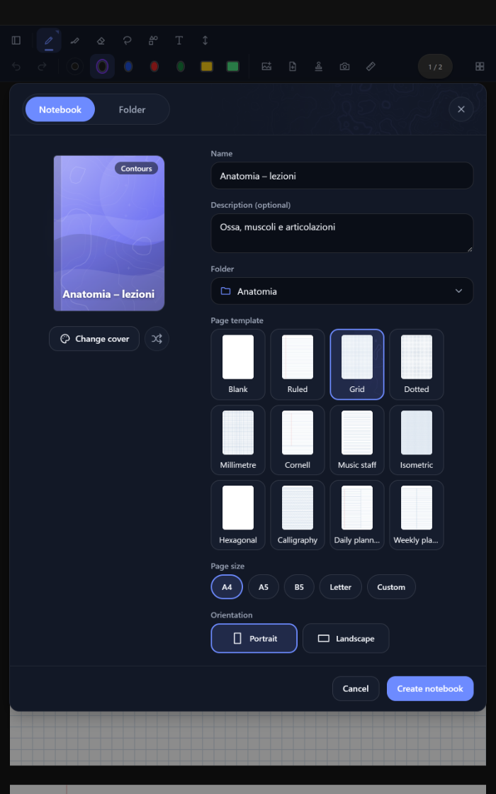
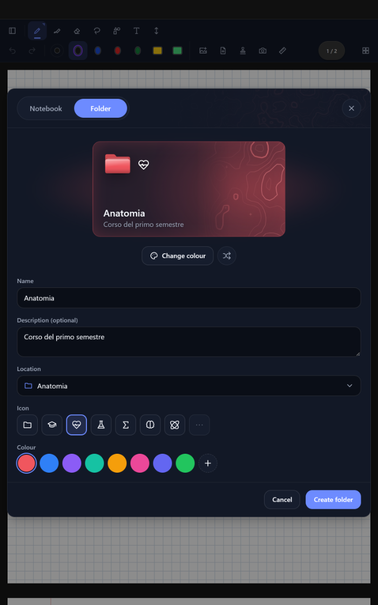
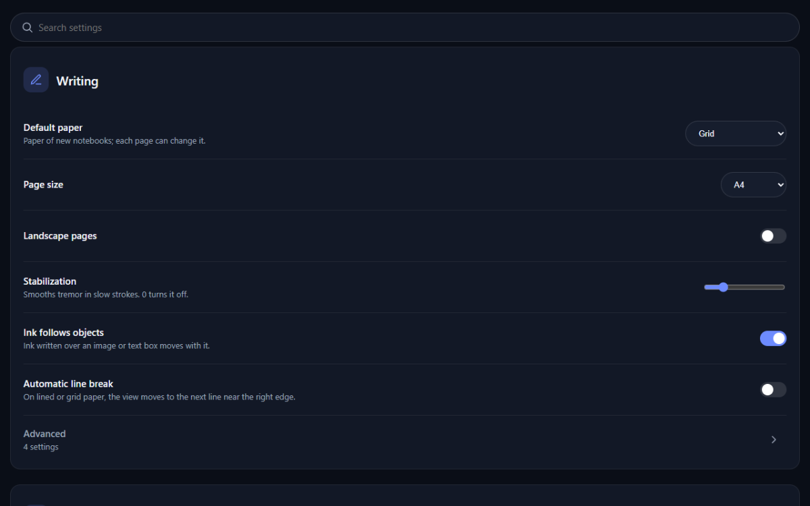
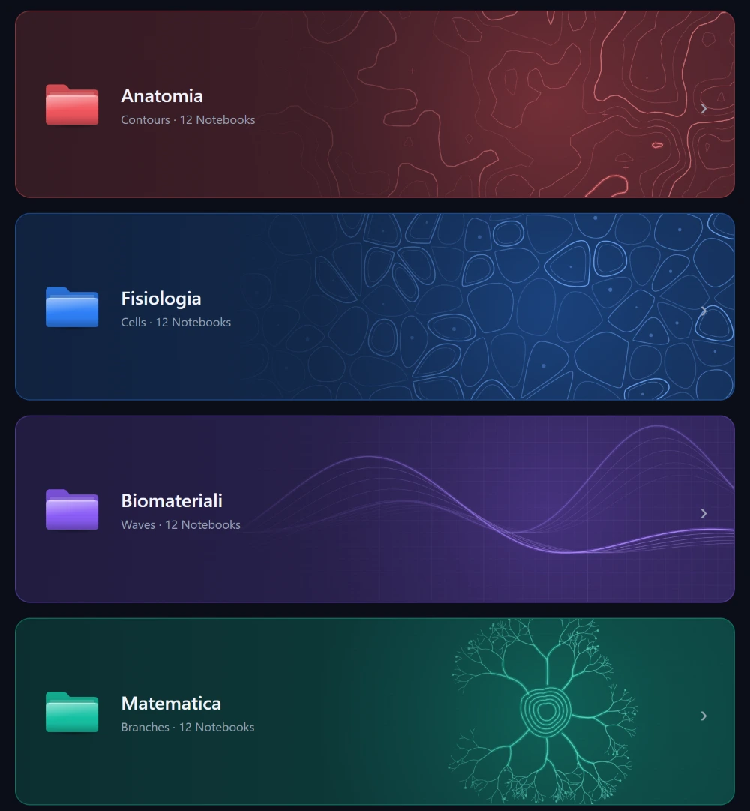

  <picture>
    <source media="(prefers-color-scheme: light)" srcset="docs/media/banner-light.png">
    
  </picture>

  
  
  
  
  

<h3 align="center">Handwrite in Obsidian — like a real notebook, with your S Pen.</h3>

  Pressure-sensitive ink, PDFs, equations and a beautiful library, saved as plain files in your vault. 
  Built first for Android tablets with a stylus, and at home on Windows too. Free, open source, local-first.

  
  &nbsp;
  

  Already in Obsidian? Open <code>obsidian://show-plugin?id=notebook</code> from your browser, or search for <b>Notebook</b> in <b>Settings → Community plugins → Browse</b>.

  <a href="#gallery">Gallery</a> ·
  <a href="#features-at-a-glance">Features</a> ·
  <a href="#quick-start">Quick start</a> ·
  <a href="#faq">FAQ</a> ·
  <a href="https://plagemes.github.io/Obsidian-Notebook/">Live roadmap</a> ·
  <a href="CHANGELOG.md">Changelog</a>

## Why Notebook

<table>
  <tr>
    <td width="50%" valign="top">
      <h3>Handwriting that feels natural</h3>
      Vector ink that follows your pen's pressure, painted as the pen moves and never reshaped when you lift it. Palm rejection, a radial menu next to the pen, the S Pen side button as an eraser, and ink that stays sharp at any zoom.
    </td>
    <td width="50%" valign="top">
      <h3>Local-first, yours for good</h3>
      Every notebook is a file in your vault. No account, no cloud, no telemetry, no AI. Sync it with what you already use: Obsidian Sync, Google Drive, OneDrive or any folder-sync app.
    </td>
  </tr>
  <tr>
    <td width="50%" valign="top">
      <h3>Made for studying</h3>
      Write on PDFs and scans, typeset equations, draw function graphs, cut a figure into your notes with an anchor back to its source, mark what to review, and practise with your answers hidden.
    </td>
    <td width="50%" valign="top">
      <h3>A library you'll enjoy opening</h3>
      A home dashboard and a library of subject folders, smart collections and covers, decorated with line art generated on your device from each subject's name and colour.
    </td>
  </tr>
</table>

## Gallery

  <picture>
    <source media="(prefers-color-scheme: light)" srcset="docs/media/home-light.webp">
    
  </picture>
   <b>Home.</b> Subject folders, the pages you edited last, statistics computed on your device, quick actions.

  <picture>
    <source media="(prefers-color-scheme: light)" srcset="docs/media/library-light.webp">
    
  </picture>
   <b>Library.</b> Filter chips, smart collections, frequent tags, recent and favourite notebooks with page thumbnails.

  <picture>
    <source media="(prefers-color-scheme: light)" srcset="docs/media/notebook-light.png">
    
  </picture>
   <b>Writing.</b> The toolbar and the radial menu: undo, redo, width, colour and tools, one tap from the pen.

<table>
  <tr>
    <td width="50%" align="center">
      <picture>
        <source media="(prefers-color-scheme: light)" srcset="docs/media/radial-color-light.png">
        
      </picture>
       <b>Colour, at the pen.</b> Twelve colours, a custom colour and an eyedropper, without leaving the page.
    </td>
    <td width="50%" align="center">
      <picture>
        <source media="(prefers-color-scheme: light)" srcset="docs/media/radial-shapes-light.png">
        
      </picture>
       <b>Shapes and tools.</b> Lines, arrows, rectangles, ellipses and the ruler from the same dial.
    </td>
  </tr>
  <tr>
    <td width="50%" align="center">
      <picture>
        <source media="(prefers-color-scheme: light)" srcset="docs/media/create-notebook-light.png">
        
      </picture>
       <b>New notebook.</b> A generated cover, real paper previews, A4 · A5 · B5 · Letter · custom.
    </td>
    <td width="50%" align="center">
      <picture>
        <source media="(prefers-color-scheme: light)" srcset="docs/media/create-folder-light.png">
        
      </picture>
       <b>New folder.</b> A subject with its own icon, colour and line art.
    </td>
  </tr>
</table>

  <picture>
    <source media="(prefers-color-scheme: light)" srcset="docs/media/settings-light.png">
    
  </picture>
   <b>Settings.</b> Organised by task, most-used options first, with search in English and Italian.

  <picture>
    <source media="(prefers-color-scheme: light)" srcset="docs/media/art-gallery-light.webp">
    
  </picture>
   <b>Generated art.</b> Four of the seven line-art families (contours, cells, waves, branches; also flow, orbits and grid), drawn on the device from a subject's name and colour.

Screenshots are taken in the project's browser test harness (<code>npm run harness:check</code>) with a demo vault, not on a device.

## Features at a glance

The highlights are below; the complete guide, with every setting, is in **[docs/features.md](docs/features.md)**.

### Writing

Ink that feels like paper and stays sharp at any zoom, because every stroke is stored as vector points with pressure.

- Pen, a highlighter that darkens what is under it instead of covering it, and an eraser for whole strokes, segments or an outlined area.
- Lasso to move, resize and rotate; shapes that turn clean when you hold still at the end; text boxes, images, a ruler and stamps.
- Radial menu next to the pen, favourite pens, palm rejection, two- and three-finger taps for undo and redo.
- Equations typeset with Obsidian's maths engine and function graphs (cartesian, parametric, polar, implicit), both kept as vectors.
- Papers: blank, ruled, grid, dotted, millimetre, Cornell, music, isometric, hexagonal, planners, and infinite pages.

### Study

Tools for lectures and revision, all computed on your device.

- Markers for gaps, questions, importance and homework (homework becomes Obsidian tasks), with an *End of lecture* panel.
- Invisible ink for answers and *Redo the exercise*: a practice copy with your ink hidden, a peek at the solution and a timer.
- Pen gestures: circle to select, scribble to delete, "^" to insert space, a star to bookmark.
- A class timetable that opens the right notebook on a new dated page, and *New lecture from slides*.
- A Zettelkasten made from handwriting: cards from a lasso selection or a page, with an inbox to process.

### PDF

Annotate slides and papers without losing the clean original.

- Import a PDF as a notebook, insert PDF pages or a scan (camera, corner detection, document and whiteboard filters).
- Search the PDF text, a highlighter that snaps to text lines, hide your annotations or dim the page, widen margins to write beside a slide.
- Open a PDF side by side with your notes, and update to a new version of the slides while your notes stay on their slides.
- Anchored excerpts: cut a figure onto another page, then tap its badge to jump back to the exact place it came from.
- Export highlights and text boxes to a Markdown note.

### Organisation

Find any page in seconds, even in a big vault.

- Home dashboard and a library with subject folders, smart collections (To study, Favourites, With PDF, Recent, Exams), tags, pins and an archive.
- Search across titles, tags and typed text (handwriting is not searched: there is no OCR).
- Pages panel with thumbnails, drag to reorder, a coloured outline of bookmarks, page tags and a *Go to page* switcher across notebooks.
- Export to PDF, SVG, PNG or Markdown with page images; print on desktop.

### Obsidian integration

Notebooks behave like part of your vault.

- Link or embed a single page: `[[Physics.notebook#p3]]`, `![[Physics.notebook#p3]]` or a `notebook` code block; `obsidian://notebook` links for other apps.
- Optional companion notes so Obsidian search, the graph, tags and Dataview see your notebooks.
- Obsidian tags, Obsidian bookmarks to a page, commands for the mobile toolbar, a [public API](docs/api.md) for Templater, QuickAdd and Dataview.
- Interface in English and Italian.

### Privacy & safety

Your notes are files you own, and the plugin works hard never to lose them.

- A `.notebook` file is versioned JSON in your vault; PDFs and images are stored once in `_assets`. No account, no cloud, no telemetry, no AI.
- Automatic saving plus an instant save journal that restores the last changes after a crash.
- Version history, *Restore a single page*, *Repair damaged notebook*. Unreadable files are never overwritten and a backup is kept.
- Sync safety for folder-sync apps: conflicted copies can be merged, an *Open on another device* banner, and an integrity check that spots stale copies.

## Quick start

1. **Install.** In Obsidian open **Settings → Community plugins → Browse**, search for **Notebook**, then **Install** and **Enable** (or open the [community page](https://community.obsidian.md/plugins/notebook)). Prefer the newest build, or a pre-release? Use [BRAT](#install-with-brat).
2. **Create your first notebook.** Tap the ribbon icon to open **Notebook home**, then **New notebook**. The creation dialog has two tabs: **Notebook** (cover, name, folder, paper, page size and orientation) and **Folder** (a subject with its own icon and colour). Choose, then **Create**.
3. **Write.** The pen writes; one finger scrolls and two fingers zoom (turn on *Draw with finger* in the settings to write with a finger). Click the S Pen side button while the pen hovers, or hold the pen still for a moment, to open the radial menu; hold the button while you write to erase.
4. **S Pen tips.** What the side button can and cannot do inside Obsidian on Android, and how to map the pen's remote button to a key, is in [S Pen on Android](docs/features.md#s-pen-on-android).
5. **Sync.** Notebooks are ordinary files: a Google Drive or OneDrive folder-sync app, Syncthing or Obsidian Sync (turn on **Other types**) all work. Sync the `_assets` and `_backup` folders too. Details in the [FAQ](#faq) and in [Versions and recovery](docs/features.md#versions-and-recovery).

### Install with BRAT

BRAT installs the latest GitHub release, pre-releases included, and keeps it updated:

1. **Settings → Community plugins → Browse**, search for **BRAT** (Obsidian42 - BRAT), install and enable it.
2. Command palette → **BRAT: Add a beta plugin for testing** → enter `https://github.com/Plagemes/Obsidian-Notebook` → choose the latest version → **Add plugin**.
3. Enable **Notebook** in **Settings → Community plugins**.

Manual install (Windows and Android) and debugging on Android are in [docs/install.md](docs/install.md).

## FAQ

<b>Is it free?</b>

Yes. Notebook is free and open source under the MIT licence. There is no paid tier, no account and no ads.

<b>Where are my notes?</b>

In your vault, as `.notebook` files (by default in the `Notebooks/` folder). PDFs and images live once in `Notebooks/_assets/`, backups and version snapshots in `Notebooks/_backup/`. Uninstalling the plugin leaves every file where it is. The format is documented in [docs/features.md](docs/features.md#file-format) and [docs/architecture.md](docs/architecture.md).

<b>Does it work on Android, iPad and Windows?</b>

It is designed first for Android tablets with a stylus (S Pen) and also for Windows. It uses no desktop-only code, so it also loads on macOS, Linux and iPad, but those are not a focus and have not been tested. On Android, Obsidian does not pass pen hover to plugins, which limits what the S Pen side button can do (see the next question).

<b>What does the S Pen button do?</b>

A click while the pen hovers opens the radial menu (or, if you choose, makes the next stroke erase). Holding the button while the nib touches the page erases, and pressing it mid-stroke erases the rest of that stroke. Because Obsidian for Android does not pass hover to plugins, anything that needs hover (a cursor preview, choosing by releasing over an action) cannot work. The full explanation, the timing settings and an optional key-mapping setup are in [S Pen on Android](docs/features.md#s-pen-on-android).

<b>Does it use AI or the cloud?</b>

No. Everything, including the generated art and the statistics, is computed by ordinary code on your device, and nothing is sent anywhere: no account, no server, no telemetry. Syncing is up to you and the tools you already use (Google Drive, OneDrive, Syncthing or Obsidian Sync). Optional AI features are only an idea for much later on the roadmap, after writing and saving are proven stable, and would be local first with any cloud use as an explicit opt-in.

## Roadmap

  

As of 0.12.5 the roadmap has **129 features shipped**, **0 in progress** and **308 to do** (plus 5 deferred and 22 dropped). The live page is rebuilt from [docs/roadmap.md](docs/roadmap.md) on every change, with filters, search and the most requested features.

  
  &nbsp;
  

## Contributing

- **Want something?** [Request a feature](https://github.com/Plagemes/Obsidian-Notebook/issues/new?template=feature_request.yml), or 👍 an existing request: the roadmap page ranks them by votes. Loose ideas are welcome in [Discussions → Ideas](https://github.com/Plagemes/Obsidian-Notebook/discussions/categories/ideas).
- **Found a bug?** [Report it](https://github.com/Plagemes/Obsidian-Notebook/issues/new?template=bug_report.yml). Reports from Android tablets with a pen help most.
- **Want to code?** Read [CONTRIBUTING.md](CONTRIBUTING.md) and [docs/development.md](docs/development.md). Please follow the [Code of Conduct](CODE_OF_CONDUCT.md); security issues go through [SECURITY.md](SECURITY.md).

<b>Status:</b> v0.12.5 (document format 11), early development. The automated tests and the browser harness pass, but Notebook has not been verified on Android hardware yet; what is verified, and how to test it, is in <a href="docs/testing.md">docs/testing.md</a>.

## Licence

MIT, see [LICENSE](LICENSE). Third-party code: perfect-freehand (MIT). PDFs are rendered with the pdf.js that Obsidian provides. No code was copied from the other projects studied in [docs/research.md](docs/research.md).
